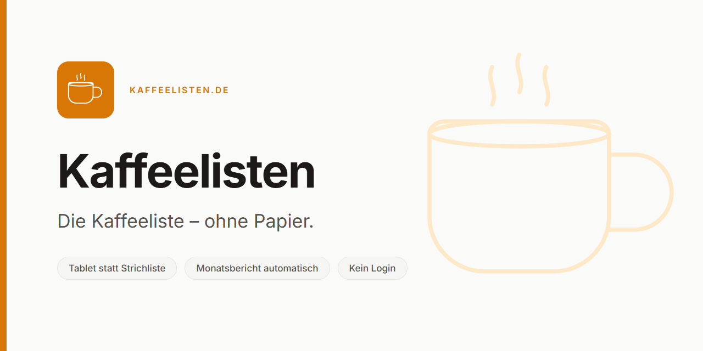

<picture>
  <source media="(prefers-color-scheme: dark)" srcset="https://raw.githubusercontent.com/kaffeelisten/.github/main/brand/social/social-preview-dark.png">
  
</picture>

# Kaffeelisten

**The paper coffee list, without the paper.**

A shared tablet stands by the coffee machine. You tap your company, tap your name, tap what you
took, and confirm. The screen resets itself. No login, no account, nothing to install — the whole
thing takes a few seconds, which is the only reason a system like this gets used instead of
ignored.

At the end of each month it compiles what everyone consumed into a report grouped by company and
by person, sends it, archives the month and resets the counters. Nothing is ever deleted.

Built for the **ITC1 Deggendorf** campus, where several small companies share a building, a coffee
machine, and until now a sheet of paper beside it.

## Why it exists

A paper list works until it doesn't. Tally marks go missing, handwriting is ambiguous, somebody
has to add it all up at month end, and the person who forgot to write something down is not
usually the person who ends up paying for it.

The interesting part of the problem is not the arithmetic. It is that any system slower than
picking up a pen will simply not be used. So the design constraint came first: **under fifteen
seconds, standing up, one-handed, holding a cup.** Everything else followed from that.

## How it is built

| | |
|---|---|
| **Frontend** | React, Vite, TypeScript, Tailwind — a PWA, installable on the tablet |
| **Database** | PostgreSQL on Supabase, with row-level security |
| **API and jobs** | serverless functions, plus a scheduled month-end run |
| **Mail** | the monthly report, as the email body rather than an attachment |

Migrations are the only path to a schema change. Months are archived, never dropped. The admin
area is PIN-protected and checked server-side.

## Repositories

| | |
|---|---|
| [`kaffeelisten`](https://github.com/kaffeelisten/kaffeelisten) | The application. Apache-2.0. |
| [`kaffeelisten.github.io`](https://github.com/kaffeelisten/kaffeelisten.github.io) | This project's site. |

Deployment repositories are configuration only, one per campus, and are kept private. There is one
application, not a copy per customer.

## Who

Built by **[Alex Rudaev](https://github.com/arudaev)** and **Fares Elbermawy**, AI and Software
Engineering students at THD Deggendorf. It started at the B4Y3RW4LD hackathon in May 2026 as an
entry to the ITC1 Kaffeelisten Challenge, and then kept going past the point where a hackathon
project normally stops.

## Running it somewhere else

Several campuses have the same sheet of paper. If yours is one of them, open an issue or get in
touch — the second deployment is deliberately much cheaper than the first.

Security reports go to [`SECURITY.md`](https://github.com/kaffeelisten/.github/blob/main/SECURITY.md),
not to the issue tracker.
